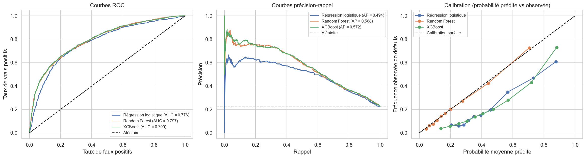
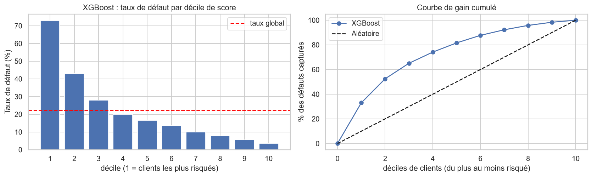

# Credit Scoring : prédiction du défaut de paiement (Taïwan, UCI)

Projet de **scoring de crédit** : prédire si un client de carte bancaire fera **défaut le mois suivant**, et comparer trois modèles : **régression logistique**, **Random Forest** et **XGBoost**.

- **Dataset :** *Default of Credit Card Clients* (UCI Machine Learning Repository, Yeh & Lien, 2009) : 30 000 clients d'une banque taïwanaise, avril à septembre 2005.
- **Livrable principal :** [`credit_default_scoring.ipynb`](credit_default_scoring.ipynb), exécuté de bout en bout sur le fichier UCI complet, commenté en français.
- **Résultat :** XGBoost retenu, ROC-AUC test ≈ **0,799** (Gini ≈ 0,60), à égalité statistique avec le Random Forest (≈ 0,797) et nettement devant la régression logistique (≈ 0,776).

> **Source des données.** Le notebook télécharge le fichier UCI complet (30 000 clients, 29 965 après suppression de 35 doublons) et les chiffres de ce dépôt viennent de cette exécution. Si le site UCI est inaccessible, il se rabat sur une copie publique de 24 000 clients (échantillon du même fichier, dépôt `pycaret/datasets`) : les chiffres sont alors légèrement différents (voir « Limites »).

---

## 1. Le problème

Une banque veut estimer, pour chaque client, la probabilité qu'il ne rembourse pas sa carte le mois suivant, afin d'ajuster ses décisions (octroi, plafond, surveillance).

| | |
|---|---|
| **Cible** | `default` : 1 = défaut le mois suivant, 0 = pas de défaut (≈ 22 % de défauts : classes déséquilibrées) |
| **Variables** | 23 : plafond de crédit (`LIMIT_BAL`), profil (`SEX`, `EDUCATION`, `MARRIAGE`, `AGE`), statut de remboursement sur 6 mois (`PAY_1`..`PAY_6`), montants facturés (`BILL_AMT1`..`6`) et payés (`PAY_AMT1`..`6`) |
| **Taille** | 30 000 clients (29 965 après suppression des doublons) |

Comme la cible est déséquilibrée, l'**accuracy seule est trompeuse** (un modèle qui répond toujours « pas de défaut » a déjà 78 %). Les modèles sont comparés sur le **ROC-AUC / Gini**, le **KS**, la **PR-AUC**, et le rappel / précision / F1 de la classe « défaut ».

## 2. Démarche du notebook

| Étape | Contenu |
|---|---|
| **1-2. Données & qualité** | Chargement, dictionnaire des variables, valeurs manquantes (aucune), doublons (35 supprimés), modalités non documentées (`EDUCATION` 0/5/6 → « autres », `MARRIAGE` 0 → « autre ») |
| **3. Analyse exploratoire** | Distribution de la cible, variables numériques et outliers (règle de l'IQR), variables catégorielles (chi-deux, V de Cramér), taux de défaut par statut de remboursement, **matrice de corrélation** et détection de multicolinéarité |
| **4. Feature engineering** | 7 variables synthétiques : nombre de mois de retard, retard maximal, moyenne des statuts, facture moyenne, taux d'utilisation du plafond (dernier mois / moyen), ratio payé / facturé |
| **5. Split & pré-traitement** | Train/test 80/20 **stratifié**, pré-traitement dans un `Pipeline` (pas de fuite d'information), log signé + standardisation des montants pour la régression logistique |
| **6. Baselines** | Classifieur naïf, trois modèles aux réglages par défaut, apport du feature engineering |
| **7. Optimisation** | `GridSearchCV` (régression logistique), `RandomizedSearchCV` (Random Forest, XGBoost), validation croisée stratifiée à 5 plis, critère ROC-AUC |
| **8. Seuil de décision** | Seuil choisi pour maximiser le F1 de la classe « défaut » sur les prédictions *out-of-fold* du train (le test n'intervient pas) |
| **9. Évaluation finale** | Test évalué **une seule fois** : ROC, précision-rappel, calibration, matrices de confusion, **intervalles de confiance bootstrap** et tests de différence entre modèles |
| **10. Interprétation** | Odds ratios (régression logistique), importance par permutation (3 modèles) |
| **11. Choix final** | Tableau de synthèse, sauvegarde du modèle, déciles de risque, courbe de gain, sensibilité du seuil au coût d'erreur |
| **12. Conclusions** | Résultats, limites, pistes |

Principes de rigueur appliqués : doublons supprimés avant le split, toute la sélection (hyperparamètres, seuil, modèle) faite par validation croisée sur le **train uniquement**, test utilisé une seule fois pour confirmer.

## 3. Résultats (jeu de test, 5 993 clients)

| Modèle | ROC-AUC | Gini | KS | PR-AUC | Rappel (défaut) | Précision (défaut) | F1 | Brier |
|---|---|---|---|---|---|---|---|---|
| Régression logistique | 0,776 | 0,55 | 0,444 | 0,494 | 0,590 | 0,495 | 0,539 | 0,190 |
| Random Forest | 0,797 | 0,59 | 0,451 | 0,568 | 0,576 | 0,531 | 0,553 | **0,131** |
| **XGBoost (retenu)** | **0,799** | **0,60** | **0,455** | **0,572** | **0,601** | 0,521 | **0,558** | 0,178 |

Seuils de décision : 0,543 (régression logistique, entraînée avec `class_weight="balanced"`), 0,286 (Random Forest), 0,557 (XGBoost, entraîné avec `scale_pos_weight` ≈ 3,5).



**À retenir**

- **Le statut de remboursement récent (`PAY_1`) est le signal dominant** : taux de défaut ≈ 13-17 % pour un client à jour, ≈ 34 % pour un mois de retard, ≈ 70 % dès deux mois. Les variables socio-démographiques pèsent très peu.
- **Random Forest et XGBoost battent la régression logistique** d'environ 0,02 de ROC-AUC (différence significative, IC 95 % bootstrap [0,014 ; 0,028] pour le Random Forest et [0,016 ; 0,029] pour XGBoost). **Entre eux, pas de différence significative** (-0,002, IC 95 % [-0,005 ; +0,001]).
- **XGBoost est retenu** : meilleur ROC-AUC en validation croisée (0,786), bien moins de sur-apprentissage que le Random Forest (écart train − CV : 0,020 contre 0,046), meilleur rappel et meilleur F1 au seuil choisi, modèle léger (< 1 Mo).
- **Ses probabilités sont toutefois mal calibrées**, comme celles de la régression logistique : la pondération des défauts (`scale_pos_weight` ≈ 3,5, `class_weight="balanced"`) les surestime (Brier 0,178 et 0,190 contre 0,131 pour le Random Forest, qui n'est pas pondéré et suit la diagonale de la courbe de calibration). Le classement des clients (ROC-AUC) n'est pas affecté, mais il faut recalibrer le score (Platt / isotonique) avant de le lire comme une probabilité de défaut.
- **Lecture métier** : le 1ᵉʳ décile de risque a un taux de défaut ≈ 73 % (lift ≈ 3,3) ; les 3 premiers déciles regroupent ≈ 65 % des défauts.



## 4. Limites

- Le plafond de performance est modeste (ROC-AUC ≈ 0,80 pour les modèles d'arbres) : peu d'historique (6 mois) et pas d'information sur le revenu ou l'ancienneté.
- Données de Taïwan en 2005 : pas de garantie de transposition à un autre contexte ou une autre période.
- Les valeurs -2 et 0 de `PAY_x` ne sont pas documentées par UCI ; l'interprétation retenue (pas de consommation / paiement minimum) est plausible mais non confirmée.
- Un seul découpage train / test. L'IC à 95 % du ROC-AUC d'un modèle est d'environ ± 0,015 : l'écart entre Random Forest et XGBoost (0,002) est dans cette marge, alors que celui avec la régression logistique (≈ 0,02) reste significatif dans la comparaison appariée (voir les IC bootstrap).
- **Le réglage de `scale_pos_weight` dépend de la recherche aléatoire.** Sur la copie de 24 000 clients, elle avait retenu `scale_pos_weight` = 1 : XGBoost y avait alors des probabilités bien calibrées (Brier 0,133) et un ROC-AUC test de 0,784, identique à celui du Random Forest. Les conclusions sur le classement des modèles sont stables, celle sur la calibration d'XGBoost ne l'est pas.

Pistes : recalibration (Platt / isotonique), Optuna, interprétation locale avec SHAP, analyse d'équité par sous-groupes, seuil fondé sur les coûts réels, LightGBM / CatBoost, suivi de dérive (PSI).

## 5. Structure du dépôt

```
.
├── credit_default_scoring.ipynb   # notebook complet (exécuté)
├── README.md
├── requirements.txt
├── data/                          # y déposer le fichier UCI (optionnel)
├── figures/                       # figures générées par le notebook
└── models/
    ├── xgboost_model.ubj          # modèle XGBoost final (format UBJSON, portable)
    └── preprocessing.joblib       # pré-traitement + seuil de décision + liste des variables
```

## 6. Reproduire

```bash
python -m venv .venv && source .venv/bin/activate    # Windows : .venv\Scripts\activate
pip install -r requirements.txt
jupyter notebook credit_default_scoring.ipynb
```

L'exécution complète dure environ 17 minutes sur un processeur à 12 threads (la recherche d'hyperparamètres domine). Les graines aléatoires sont fixées (`RANDOM_STATE = 51016`).

Les résultats et les fichiers de `models/` ont été produits avec Python 3.13, scikit-learn 1.9.1, xgboost 3.4.1, pandas 3.0.6, numpy 2.5.4, scipy 1.18.1, matplotlib 3.11.2 et seaborn 0.13.2 (les versions ne sont pas verrouillées dans `requirements.txt`). Pour relire les fichiers de `models/`, utiliser ces versions ou des versions plus récentes.

### Données

Le notebook cherche le dataset dans cet ordre :

1. un fichier local de `data/` (par exemple `default of credit card clients.xls`, à télécharger depuis <https://archive.ics.uci.edu/dataset/350/default+of+credit+card+clients>) ;
2. le téléchargement direct depuis UCI (30 000 clients) : c'est le chemin utilisé pour les résultats de ce dépôt ;
3. en dernier recours, la copie de 24 000 clients (`pycaret/datasets`).

La première cellule de chargement affiche la source utilisée et le nombre de lignes : vérifiez qu'elle indique bien 30 000 lignes.

### Charger le modèle sauvegardé

Le modèle tient en deux fichiers : le modèle XGBoost (format UBJSON) et le pré-traitement avec le seuil et la liste des variables.

```python
import joblib
from xgboost import XGBClassifier

bundle = joblib.load("models/preprocessing.joblib")
preprocessor, threshold, features = bundle["preprocessor"], bundle["threshold"], bundle["features"]
clf = XGBClassifier()
clf.load_model("models/xgboost_model.ubj")

# X : DataFrame contenant les colonnes d'origine ET les 7 variables engineered (fonction add_features du notebook, section 4)
score = clf.predict_proba(preprocessor.transform(X[features]))[:, 1]
alerte = score >= threshold
```

- **Appliquer d'abord le nettoyage de la section 2.4 du notebook** : `EDUCATION` 0, 5, 6 → 4 et `MARRIAGE` 0 → 3. Sinon aucune erreur n'est levée (le pré-traitement ignore les modalités inconnues) mais les scores sont faussés : sur des clients simulés, passer `EDUCATION = 5` au lieu de 4 décale le score de 0,09 en moyenne (jusqu'à 0,23).
- **Le score n'est pas une probabilité calibrée** (voir « Résultats ») : il sert à classer les clients et à comparer au seuil, pas à lire un taux de défaut sans recalibration.
- **Pourquoi deux fichiers ?** Un `joblib.dump` du pipeline complet ne se recharge pas d'un système d'exploitation à l'autre : XGBoost y inscrit l'état de son générateur aléatoire dans un format texte propre à la plateforme (un modèle enregistré sous Linux échoue sous Windows avec `XGBoostError: input stream corrupted`). Le format UBJSON n'a pas ce défaut.

## 7. Références

- Yeh, I-C., & Lien, C-H. (2009). *The comparisons of data mining techniques for the predictive accuracy of probability of default of credit card clients.* Expert Systems with Applications, 36(2).
- Dataset UCI : <https://archive.ics.uci.edu/dataset/350/default+of+credit+card+clients> (licence CC BY 4.0).
